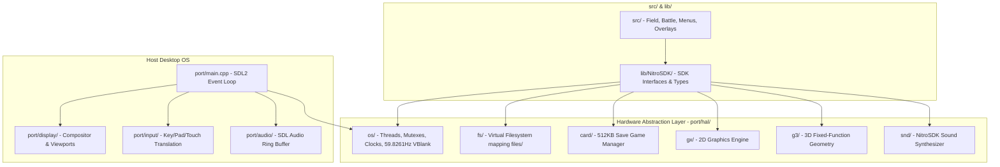

# Architecture: Pokémon HeartGold Native PC Port

This document outlines the high-level architecture of the native PC port for Pokémon HeartGold/SoulSilver.

## Overview

The native PC port project recompiles the original C decompilation of Pokémon HeartGold into a standalone 64-bit desktop application for Linux, Windows, and macOS, without relying on an emulator.

## Subsystem Layout & Current Implementation Status

- `port/`: Desktop platform host implementation and Hardware Abstraction Layer (HAL).
  - `port/main.cpp`: Standalone executable entry point with SDL2 lifecycle, window creation, OpenGL 3.3 Core context, and 59.8261 Hz frame loop.
  - `port/include/`:
    - `port_common.h`: Core display modes, viewport structures, math macros, and timing constants.
    - `port_os.h`: Native OS HAL definitions (threads, mutexes, ticks, IRQs, VBlank).
    - `port_vfs.h`: Native VFS contract and NitroFS stream APIs (`FS_OpenFile`, `FS_ReadFile`, `FS_SeekFile`, `FS_CloseFile`).
    - `nitro/types.h`: 64-bit normalized exact-width types mapped to `<stdint.h>`.
  - `port/hal/os/`:
    - `os_thread.cpp`: C++17 threading and recursive mutex abstraction.
    - `os_time.cpp`: 33.513982 MHz virtual clock and microsecond/millisecond tick conversion.
    - `os_interrupt.cpp`: IRQ callback table, master interrupt flag, and 59.8261 Hz virtual VBlank unblocking.
  - `port/hal/fs/`:
    - `fs_vfs.cpp`: Virtual filesystem resolving Nintendo DS asset paths (`rom:/`, `data:/`, relative) to host `files/`.
  - `port/display/`: Dual-screen OpenGL compositor and mouse-to-touchscreen coordinate transformation.
  - `port/input/`: Keyboard, gamepad controller mapping, and digitizer emulation.
  - `port/audio/`: PCM audio streaming and thread-safe circular ring buffer.
  - `port/tests/`:
    - `test_runner.h`: Header-only lightweight unit testing framework.
    - `test_runner.cpp`: Automated unit test suite run via `ctest` (10 passing suites).
- `lib/include/nitro/types.h`: Protected with `#ifdef PLATFORM_NATIVE` for 64-bit integer type normalization across compilers.
