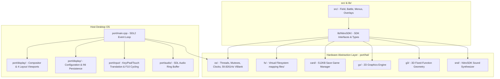

# Architecture: Pokémon HeartGold Native PC Port

This document outlines the high-level architecture of the native PC port for Pokémon HeartGold/SoulSilver.

## Overview

The native PC port project recompiles the original C decompilation of Pokémon HeartGold into a standalone 64-bit desktop application for Linux, Windows, and macOS, without relying on an emulator.

## Subsystem Layout & Current Implementation Status

- `port/`: Desktop platform host implementation and Hardware Abstraction Layer (HAL).
  - `port/main.cpp`: Standalone executable entry point with SDL2 lifecycle, window creation, OpenGL 3.3 Core context, preference loading, and 59.8261 Hz frame loop.
  - `port/include/`:
    - `port_common.h`: Core display modes, viewport structures, math macros, and timing constants.
    - `port_os.h`: Native OS HAL definitions (threads, mutexes, ticks, IRQs, VBlank).
    - `port_vfs.h`: Native VFS contract and NitroFS stream APIs (`FS_OpenFile`, `FS_ReadFile`, `FS_SeekFile`, `FS_CloseFile`).
    - `port_gx.h`: 2D Graphics Engine declarations, RGB555-to-RGBA conversion, and frame rendering.
    - `port_g3.h`: 3D fixed-function geometry matrix modes, transforms, colors, and primitive dispatch.
    - `nitro/types.h`: 64-bit normalized exact-width types mapped to `<stdint.h>`.
  - `port/display/`:
    - `display_manager.h` / `display_manager.cpp`: Dual-screen compositor supporting all 4 layout modes (Horizontal Default, Swapped Horizontal, Vertical Classic DS, Swapped Vertical), pillarboxing/letterboxing, and dynamic mouse-to-touchscreen coordinate transformation.
    - `display_config.h` / `display_config.cpp`: Display preferences persistence saving/loading layout mode, resolution, fullscreen, and vsync to `display_config.ini`.
    - `framebuffer.h` / `framebuffer.cpp`: Dual 256x192 offscreen OpenGL render textures (Top FBO and Touchscreen FBO) with CPU pixel buffers.
  - `port/input/`:
    - `input_manager.h` / `input_manager.cpp`: Keyboard and SDL gamepad button mapping to `PAD_BUTTON_*` masks, layout cycling hotkey (`F10`), and mouse drag-to-touch digitizer coordinates.
  - `port/hal/os/`:
    - `os_thread.cpp`: C++17 threading and recursive mutex abstraction.
    - `os_time.cpp`: 33.513982 MHz virtual clock and microsecond/millisecond tick conversion.
    - `os_interrupt.cpp`: IRQ callback table, master interrupt flag, and 59.8261 Hz virtual VBlank unblocking.
  - `port/hal/fs/`:
    - `fs_vfs.cpp`: Virtual filesystem resolving Nintendo DS asset paths (`rom:/`, `data:/`, relative) to host `files/`.
  - `port/hal/gx/`:
    - `gx_native.cpp`: 2D graphics engine emulation for BG and OAM planes, palettes, and frame buffers.
  - `port/hal/g3/`:
    - `g3_native.cpp`: 3D fixed-function geometry pipeline translating matrix modes, transforms, vertices, and primitives to OpenGL.
  - `port/audio/`:
    - `audio_backend.h` / `audio_backend.cpp`: Lock-free circular PCM audio ring buffer (`PortAudio::AudioRingBuffer`) and SDL Audio streaming callback backend.
  - `port/hal/card/`:
    - `card_backup.cpp`: 512KB persistent save game manager with atomic file flushing (`pokemon_heartgold.sav`) and NitroSDK `CARD_` emulation.
  - `port/hal/snd/`:
    - `snd_native.cpp`: NitroSDK `SND_` subsystem emulation with master volume scaling and routing to native audio output.
  - `port/tests/`:
    - `test_runner.h`: Header-only lightweight unit testing framework.
    - `test_runner.cpp`: Automated unit test suite run via `ctest` (32 passing test suites).
    - `test_coordinates.cpp`: Aspect ratio math and mouse-to-touchscreen coordinate translation test suites.
    - `test_layouts.cpp`: Viewport calculations and mouse mapping for all 4 layout configurations.
    - `test_ring_buffer.cpp`: Circular audio ring buffer write/read, wraparound, and underrun silence handling.
    - `test_save_backup.cpp`: 512KB save game initialization (0xFF erase state), write/read persistence, and async callbacks.
- `lib/include/nitro/types.h`: Protected with `#ifdef PLATFORM_NATIVE` for 64-bit integer type normalization across compilers.
