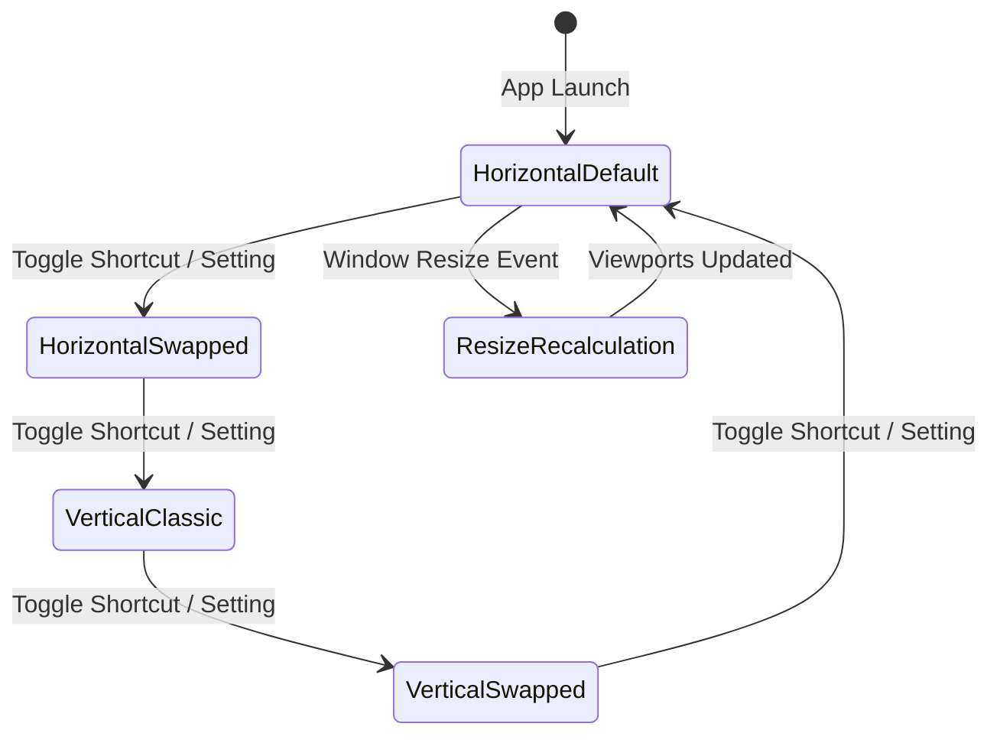
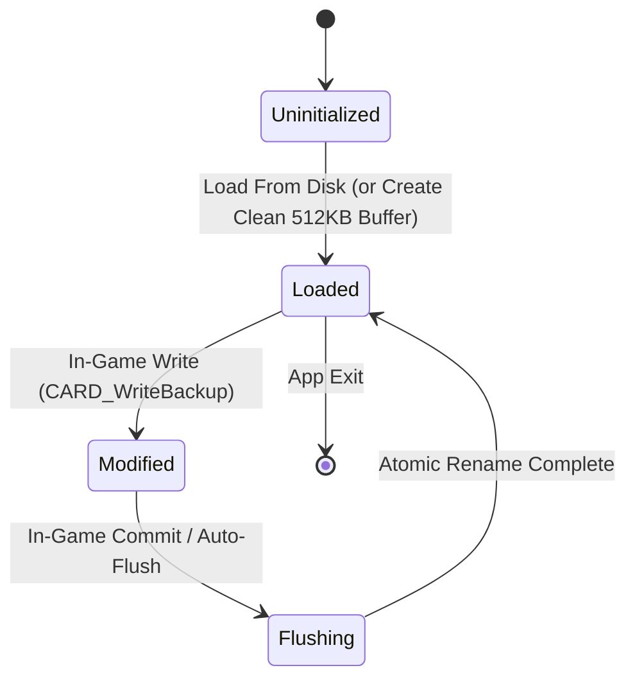

# Data Model: Native PC Port Architecture

**Feature**: Native PC Port with Configurable Dual-Screen Display  
**Branch**: `001-native-pc-port`  
**Date**: 2026-11-08  
**Status**: Draft  

---

## 1. Display and Viewport Entities

### `DisplayLayoutMode` (Enum)
Defines the spatial arrangement of the two Nintendo DS viewports inside the native PC window.

```c
typedef enum {
    DISPLAY_LAYOUT_HORIZONTAL_DEFAULT = 0, // Top Screen Left, Touchscreen Right (Widescreen default)
    DISPLAY_LAYOUT_HORIZONTAL_SWAPPED = 1, // Touchscreen Left, Top Screen Right
    DISPLAY_LAYOUT_VERTICAL_CLASSIC   = 2, // Top Screen Above, Touchscreen Below (Classic DS)
    DISPLAY_LAYOUT_VERTICAL_SWAPPED   = 3  // Touchscreen Above, Top Screen Below
} DisplayLayoutMode;
```

---

### `ViewportRect`
Represents the target bounding box of a Nintendo DS screen rendered inside the host window.

| Field | Type | Description | Constraints |
|---|---|---|---|
| `x` | `int32_t` | Top-left X coordinate in host window pixels | $\ge 0$ |
| `y` | `int32_t` | Top-left Y coordinate in host window pixels | $\ge 0$ |
| `width` | `int32_t` | Rendered width in host window pixels | $> 0$, Aspect ratio strictly $4:3$ |
| `height` | `int32_t` | Rendered height in host window pixels | $> 0$, $w / h = 4.0 / 3.0$ |

**Coordinate Mapping Methods**:
- `Point HostToTouch(const ViewportRect* vp, int32_t hostX, int32_t hostY)`:
  - If $(hostX, hostY)$ is inside $[vp.x, vp.x + vp.width) \times [vp.y, vp.y + vp.height)$:
    - $x_{ds} = \text{clamp}\left(\lfloor \frac{hostX - vp.x}{vp.width} \times 256.0 \rfloor, 0, 255\right)$
    - $y_{ds} = \text{clamp}\left(\lfloor \frac{hostY - vp.y}{vp.height} \times 192.0 \rfloor, 0, 191\right)$
    - Returns `(x_ds, y_ds, touching=true)`
  - Else returns `(0, 0, touching=false)`

---

### `DisplayConfig`
Encapsulates host window geometry, layout configuration, and viewport cache.

| Field | Type | Default Value | Description |
|---|---|---|---|
| `mode` | `DisplayLayoutMode` | `HORIZONTAL_DEFAULT` | Active layout arrangement |
| `windowWidth` | `uint32_t` | 1280 | Current host window pixel width |
| `windowHeight` | `uint32_t` | 720 | Current host window pixel height |
| `isFullscreen` | `bool` | `false` | Whether host window is fullscreen |
| `vsyncEnabled` | `bool` | `true` | Vertical sync enabled |
| `topViewport` | `ViewportRect` | Computed | Target rect for Top Screen (256x192) |
| `touchViewport` | `ViewportRect` | Computed | Target rect for Touchscreen (256x192) |

**State Transitions**:


---

## 2. Input Entities

### `TouchInputState`
Normalizes mouse and touch inputs into the Nintendo DS hardware digitizer protocol (`TP_GetRawPoint`).

| Field | Type | Range | Description |
|---|---|---|---|
| `touching` | `bool` | `true` / `false` | Whether pen/mouse is contacting the screen |
| `rawX` | `uint16_t` | $0 \dots 4095$ | Raw 12-bit ADC digitizer X coordinate |
| `rawY` | `uint16_t` | $0 \dots 4095$ | Raw 12-bit ADC digitizer Y coordinate |
| `screenX` | `uint8_t` | $0 \dots 255$ | Calibrated screen space X pixel |
| `screenY` | `uint8_t` | $0 \dots 191$ | Calibrated screen space Y pixel |
| `validity` | `uint8_t` | `TP_TOUCH_VALID` | Validity flag matching NitroSDK TP API |

---

### `InputMappingConfig`
Maps physical host keyboard keys and gamepad buttons to virtual Nintendo DS buttons.

| DS Virtual Button | Default Keyboard Key | Default Gamepad Button |
|---|---|---|
| `PAD_BUTTON_A` | `SDLK_x` | `SDL_CONTROLLER_BUTTON_A` (or B on Nintendo layout) |
| `PAD_BUTTON_B` | `SDLK_z` | `SDL_CONTROLLER_BUTTON_B` (or A on Nintendo layout) |
| `PAD_BUTTON_X` | `SDLK_s` | `SDL_CONTROLLER_BUTTON_X` |
| `PAD_BUTTON_Y` | `SDLK_a` | `SDL_CONTROLLER_BUTTON_Y` |
| `PAD_KEY_UP` | `SDLK_UP` | `SDL_CONTROLLER_BUTTON_DPAD_UP` |
| `PAD_KEY_DOWN` | `SDLK_DOWN` | `SDL_CONTROLLER_BUTTON_DPAD_DOWN` |
| `PAD_KEY_LEFT` | `SDLK_LEFT` | `SDL_CONTROLLER_BUTTON_DPAD_LEFT` |
| `PAD_KEY_RIGHT` | `SDLK_RIGHT` | `SDL_CONTROLLER_BUTTON_DPAD_RIGHT` |
| `PAD_BUTTON_L` | `SDLK_q` | `SDL_CONTROLLER_BUTTON_LEFTSHOULDER` |
| `PAD_BUTTON_R` | `SDLK_w` | `SDL_CONTROLLER_BUTTON_RIGHTSHOULDER` |
| `PAD_BUTTON_START` | `SDLK_RETURN` | `SDL_CONTROLLER_BUTTON_START` |
| `PAD_BUTTON_SELECT` | `SDLK_BACKSPACE` | `SDL_CONTROLLER_BUTTON_BACK` |
| *Layout Toggle Hotkey* | `SDLK_F10` | `SDL_CONTROLLER_BUTTON_MISC1` (if available) |
| *Fullscreen Hotkey* | `SDLK_F11` | None |

---

## 3. Storage & Audio Entities

### `SaveGameProfile`
Manages persistent game progress on the host filesystem.

| Field | Type | Description |
|---|---|---|
| `filePath` | `char[1024]` | Absolute path to the persistent save file |
| `dataSize` | `size_t` | Exactly 524,288 bytes (512 KB standard DS Flash backup) |
| `isDirty` | `bool` | True when in-game write operations have altered RAM buffer |
| `lastSaveTime` | `uint64_t` | POSIX timestamp of last disk flush |

**State Lifecycle**:


---

### `AudioRingBuffer`
Thread-safe circular PCM buffer connecting NitroSDK audio synthesis to host SDL audio device.

| Field | Type | Description |
|---|---|---|
| `buffer` | `int16_t*` | Interleaved 16-bit signed stereo PCM samples |
| `capacitySamples` | `size_t` | Capacity in sample frames (e.g. 4096 samples) |
| `sampleRate` | `uint32_t` | 32768 Hz (DS native) or 44100 / 48000 Hz |
| `readIndex` | `std::atomic<size_t>` | Consumer index read by SDL audio callback |
| `writeIndex` | `std::atomic<size_t>` | Producer index written by SND synthesis thread |