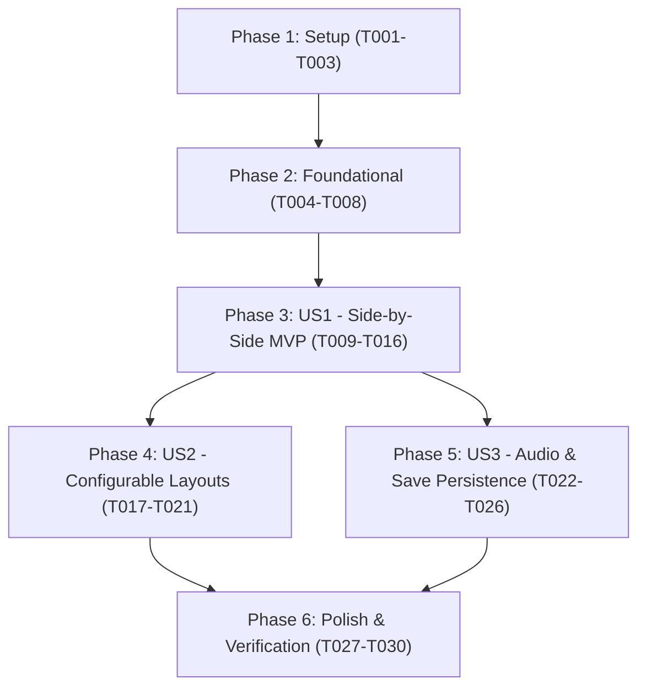

# Tasks: Native PC Port with Configurable Dual-Screen Display

**Input**: Design documents from `specs/001-native-pc-port/`  
**Prerequisites**: [plan.md](./plan.md) (required), [spec.md](./spec.md) (required), [research.md](./research.md), [data-model.md](./data-model.md), [contracts/](./contracts/), [quickstart.md](./quickstart.md)  

**Organization**: Tasks are grouped into Setup, Foundational prerequisites, User Stories (P1 -> P2 -> P3), and Polish phases to enable independent implementation and testing of each story.

## Format: `[ID] [P?] [Story] Description`
- **[P]**: Can run in parallel (different files, no blocking dependencies)
- **[Story]**: Which user story this task belongs to (`[US1]`, `[US2]`, `[US3]`)
- Every task includes exact file paths

---

## Phase 1: Setup (Shared Infrastructure)

**Purpose**: Project initialization, build system setup, and common definitions.

- [x] T001 Setup native build configuration in CMakeLists.txt with SDL2 and OpenGL 3.3 Core dependencies
- [x] T002 [P] Create port directory layout and common definitions in port/include/port_common.h
- [x] T003 [P] Create unit test harness and runner in port/tests/test_runner.cpp

---

## Phase 2: Foundational (Blocking Prerequisites)

**Purpose**: Core hardware abstraction layer (HAL) that MUST be complete before ANY user story can execute.

**⚠️ CRITICAL**: Foundational tasks block all user story gameplay features.

- [x] T004 Implement native OS threading and mutex abstraction in port/hal/os/os_thread.cpp
- [x] T005 [P] Implement native virtual clock and 59.8261 Hz VBlank interrupt handling in port/hal/os/os_time.cpp and port/hal/os/os_interrupt.cpp
- [x] T006 [P] Implement Virtual Filesystem (VFS) to resolve and stream ROM assets from files/ in port/hal/fs/fs_vfs.cpp
- [x] T007 [P] Implement 64-bit type normalization guards in lib/include/nitro/types.h
- [x] T008 Implement native entry point skeleton and SDL2 event loop in port/main.cpp

**Checkpoint**: Foundation ready - User Story 1 (MVP) implementation can now proceed.

---

## Phase 3: User Story 1 - Native PC Gameplay with Side-by-Side Dual Screens (Priority: P1) 🎯 MVP

**Goal**: Deliver a standalone playable PC application rendering both Nintendo DS screens side-by-side (Top Screen left, Touchscreen right) at 60 FPS on modern widescreen displays, controlled with keyboard/gamepad and mouse touch interaction.

**Independent Test**: Launch the compiled native executable, verify both screens render smoothly side-by-side at 60 FPS, control character movement via keyboard/controller, and interact with the right-hand touchscreen via mouse cursor clicks.

### Tests for User Story 1

- [x] T009 [P] [US1] Implement unit test for coordinate translation and aspect ratio math in port/tests/test_coordinates.cpp

### Implementation for User Story 1

- [x] T010 [P] [US1] Implement dual offscreen framebuffer management (Top Screen FBO 256x192, Touchscreen FBO 256x192) in port/display/framebuffer.cpp
- [x] T011 [US1] Implement horizontal side-by-side dual-screen compositor and viewport scaling in port/display/display_manager.cpp
- [x] T012 [P] [US1] Implement keyboard and SDL gamepad button mapping to NitroSDK PAD_BUTTON_* masks in port/input/input_manager.cpp
- [x] T013 [US1] Implement mouse-to-touchscreen coordinate translation (DisplayManager_ScreenToTouchCoords) for horizontal mode in port/display/display_manager.cpp
- [x] T014 [US1] Implement 2D graphics engine emulation for BG and OAM in port/hal/gx/gx_native.cpp
- [x] T015 [US1] Implement basic 3D geometry fixed-function pipeline translation in port/hal/g3/g3_native.cpp
- [x] T016 [US1] Integrate main loop with graphics presentation, input polling, and VBlank pacing in port/main.cpp

**Checkpoint**: User Story 1 is fully functional and independently testable as an MVP increment.

---

## Phase 4: User Story 2 - Configurable Screen Layouts and Orientation (Priority: P2)

**Goal**: Allow players to switch dynamically among 4 dual-screen layout modes (Horizontal Default, Swapped Horizontal, Vertical Classic DS, Swapped Vertical) via hotkey (F10), with touch coordinates and aspect ratio pillarboxing/letterboxing adapting seamlessly.

**Independent Test**: Press F10 during gameplay to cycle through all 4 layout configurations; confirm that viewports rearrange instantly without graphics corruption and that mouse clicks accurately hit touch elements in whichever position the touchscreen occupies.

### Tests for User Story 2

- [ ] T017 [P] [US2] Implement unit tests for all 4 layout viewport calculations and mouse mapping in port/tests/test_layouts.cpp

### Implementation for User Story 2

- [ ] T018 [US2] Extend DisplayManager to support all 4 layout modes with letterboxing/pillarboxing in port/display/display_manager.cpp
- [ ] T019 [US2] Implement layout cycling function and F10 hotkey detection in port/input/input_manager.cpp
- [ ] T020 [US2] Extend coordinate transform across all 4 layout modes and dynamic window scales in port/display/display_manager.cpp
- [ ] T021 [US2] Implement display preference persistence for layout mode and window size in port/display/display_config.cpp

**Checkpoint**: User Stories 1 and 2 operate seamlessly together with dynamic layout reconfiguration.

---

## Phase 5: User Story 3 - Audio Synthesis and Save Game Persistence (Priority: P3)

**Goal**: Synthesize and output synchronized stereo sound effects and background music via SDL Audio, and persist game progress to a standard 512KB save file on the host filesystem.

**Independent Test**: Play the game with audio enabled, verify music and sound effects playback in stereo without clicks or desync, save progress through in-game menu, restart the application, and verify the continue option loads the saved game state.

### Tests for User Story 3

- [ ] T022 [P] [US3] Implement unit test for audio circular ring buffer in port/tests/test_ring_buffer.cpp
- [ ] T023 [P] [US3] Implement unit test for save backup reading/writing in port/tests/test_save_backup.cpp

### Implementation for User Story 3

- [ ] T024 [P] [US3] Implement thread-safe PCM audio ring buffer and SDL audio callback backend in port/audio/audio_backend.cpp
- [ ] T025 [US3] Connect NitroSDK sound subsystem output to native audio stream in port/hal/snd/snd_native.cpp
- [ ] T026 [US3] Implement persistent 512KB save game manager with atomic flush in port/hal/card/card_backup.cpp

**Checkpoint**: All three user stories are complete, delivering full standalone gameplay with graphics, audio, configurable displays, and persistence.

---

## Phase 6: Polish & Cross-Cutting Concerns

**Purpose**: Optimization, build automation, overlay loading, and end-to-end verification.

- [ ] T027 [P] Implement overlay monolithic initialization table and symbol dispatch in port/hal/os/overlay_manager.cpp
- [ ] T028 [P] Add fullscreen toggle hotkey (F11) with borderless display mode in port/display/display_manager.cpp
- [ ] T029 Execute full build validation and run automated test suite via ctest in build-native/
- [ ] T030 Validate end-to-end user workflows per specs/001-native-pc-port/quickstart.md

---

## Dependencies & Execution Order

### Phase Dependencies

### User Story Dependencies

- **User Story 1 (P1)**: Depends strictly on Phase 2 (Foundational). Delivers the standalone MVP.
- **User Story 2 (P2)**: Builds upon the display and input foundations of US1. Enhances compositor with 4 layout modes and hotkey cycling.
- **User Story 3 (P3)**: Runs in parallel with or after US1. Connects NitroSDK audio synthesizer and card backup to native host devices.

---

## Parallel Opportunities

- **Setup & Foundational**:
  - `T002` (port_common.h), `T003` (test_runner.cpp), `T005` (os_time.cpp), `T006` (fs_vfs.cpp), `T007` (types.h) can all be developed in parallel.
- **User Story 1**:
  - `T009` (coordinate tests), `T010` (FBOs), and `T012` (input manager) can be developed in parallel.
- **User Story 2 & User Story 3**:
  - Once US1 is functional, US2 (Layouts) and US3 (Audio & Save) can be developed completely in parallel by separate developers or subagents.

---

## Implementation Strategy

### MVP First (User Story 1 Only)
1. Complete **Phase 1: Setup** (`CMakeLists.txt`, `port_common.h`).
2. Complete **Phase 2: Foundational** (OS threads, VBlank timer, VFS).
3. Complete **Phase 3: User Story 1** (Dual FBOs, Horizontal Side-by-Side compositor, input polling, mouse-touch translation, 2D/3D rendering, main loop).
4. **VALIDATE MVP**: Launch the application, move character, click on touchscreen.

### Incremental Feature Additions
1. Add **User Story 2**: Introduce 4-mode layout switcher (`F10`) and dynamic touch coordinate transformation.
2. Add **User Story 3**: Activate SDL audio playback and persistent save file creation.
3. Complete **Polish**: Overlay dispatch table, fullscreen shortcut (`F11`), and automated `ctest` runs.
