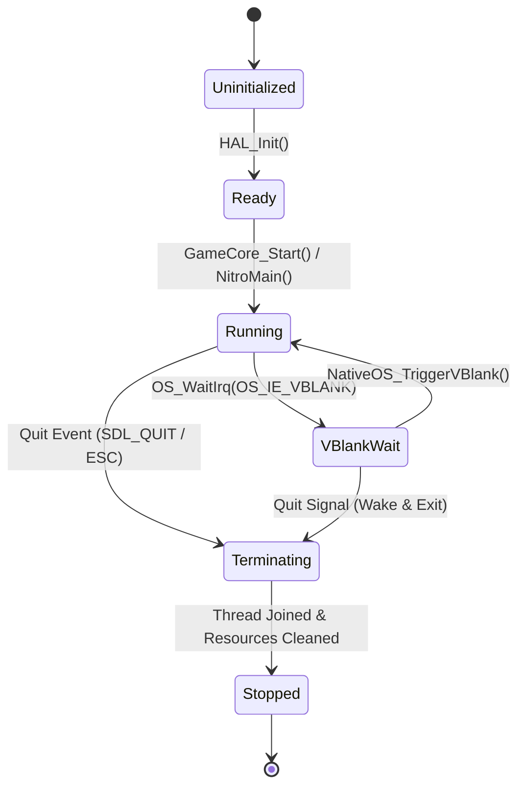

# Data Model: Game Core Integration & Window Branding

**Feature**: `002-game-core-integration`  
**Date**: 2026-11-08  
**Status**: Completed

---

## Entities

### 1. `RomIcon`
Represents the decoded 32x32 application icon extracted from ROM metadata and applied to the host desktop window.

| Field | Type | Description |
|---|---|---|
| `width` | `int32_t` | Width of the icon in pixels (fixed at 32) |
| `height` | `int32_t` | Height of the icon in pixels (fixed at 32) |
| `pixelData` | `const uint32_t*` | 1,024 32-bit RGBA pixel entries (little-endian: 0xAABBGGRR) |
| `isEmbedded` | `bool` | True if using the compiled-in fallback asset |

**Validation Rules**:
- `width == 32 && height == 32`
- `pixelData != nullptr`
- Color values must preserve transparency (`alpha == 0x00` for color 0 transparent regions).

---

### 2. `GameCoreState`
Manages the lifecycle, threading, and synchronization of the decompiled engine core (`NitroMain`).

| Field | Type | Description |
|---|---|---|
| `isRunning` | `std::atomic<bool>` | True while the game logic loop is executing |
| `isQuitRequested` | `std::atomic<bool>` | Flag set by host UI thread to command clean engine shutdown |
| `gameThread` | `std::thread` | Host thread executing `NitroMain()` |
| `vblankMutex` | `std::mutex` | Mutex protecting the virtual VBlank condition variable |
| `vblankCv` | `std::condition_variable` | Condition variable unblocking `OS_WaitIrq(TRUE, OS_IE_VBLANK)` |
| `vblankSignalCount` | `std::atomic<uint64_t>`| Monotonically increasing VBlank frame trigger counter |
| `gameFrameCount` | `std::atomic<uint64_t>`| Count of frames completed by the game core |

**State Transitions**:

---

### 3. `HardwareIoRegisters`
Structured representation of Nintendo DS memory-mapped I/O registers accessed by `src/`.

| Field | Type | Description |
|---|---|---|
| `dispCntMain` | `uint32_t` | Main screen display control (`reg_GX_DISPCNT`) |
| `dispCntSub` | `uint32_t` | Sub screen display control (`reg_GXS_DB_DISPCNT`) |
| `bgCntMain[4]` | `uint16_t` | Background 0..3 control for main 2D engine |
| `bgCntSub[4]` | `uint16_t` | Background 0..3 control for sub 2D engine |
| `masterBrightMain` | `int16_t` | Master brightness control (-16 to +16) |
| `masterBrightSub` | `int16_t` | Master brightness control (-16 to +16) |
| `vramBuffer` | `uint8_t[512 * 1024]` | Emulated VRAM banks A-D (512 KB) |

---

### 4. `InputBridgeState`
Bridges host keyboard, gamepad, and mouse events directly into Nintendo DS system structures.

| Field | Type | Description |
|---|---|---|
| `rawKeypadBits` | `uint16_t` | Nintendo DS active-low / active-high button mask |
| `touchPosition` | `struct TouchCoords` | Screen coordinates (`x`: 0..255, `y`: 0..191) |
| `touchPressed` | `bool` | True when mouse left-click or touchscreen touch is active |
| `touchRawX` | `uint16_t` | Digitizer raw ADC value (0..4095) |
| `touchRawY` | `uint16_t` | Digitizer raw ADC value (0..4095) |
