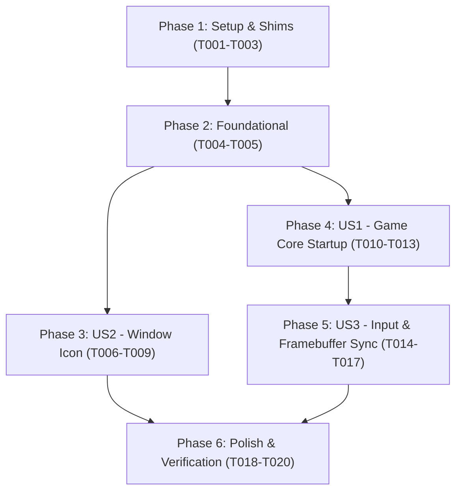

# Tasks: Game Core Integration & Window Branding

**Feature**: `002-game-core-integration`  
**Input**: Design artifacts from `/specs/002-game-core-integration/`  
**Status**: Ready for Implementation

---

## Phase 1: Setup & Build Pipeline

**Purpose**: Configure CMake to include decompiled engine sources and supply Nintendo DS SDK forwarder shims.

- [X] T001 Update root CMakeLists.txt to compile decompiled engine modules and add port/include to search paths
- [X] T002 [P] Create Nintendo DS SDK forwarder shims in port/include/MSL.h, port/include/nitro.h, port/include/nnsys.h, and port/include/nitro/code16.h
- [X] T003 [P] Implement virtual hardware memory arena and emulated I/O registers in port/include/port_hw_registers.h and port/hal/gx/hw_registers.cpp

---

## Phase 2: Foundational HAL Enhancements

**Purpose**: Core synchronization barriers and game thread execution primitives.

- [X] T004 Implement VBlank condition-variable barrier and thread synchronization in port/hal/os/os_interrupt.cpp
- [X] T005 [P] Implement GameCore thread manager and lifecycle controller in port/include/port_game_core.h and port/hal/os/game_core.cpp

---

## Phase 3: User Story 2 - Official ROM Window Icon & Title Branding (Priority: P2)

**Goal**: Extract and decode the official 32x32 Pokémon HeartGold cartridge icon from ROM metadata and apply it to the desktop window and taskbar. *(Note: US2 is sequenced in Phase 3 before US1 as an immediate, self-contained quick-win before the extensive engine bootstrap in Phase 4).*

**Independent Test**: Launch `./build-native/pokeheartgold`, inspect the window titlebar and OS taskbar, and verify that the 32x32 HeartGold icon is rendered sharply with proper transparency.

### Tests for User Story 2

- [X] T006 [P] [US2] Implement unit test for 32x32 ROM icon decoding and dimensions in port/tests/test_rom_icon.cpp

### Implementation for User Story 2

- [X] T007 [P] [US2] Generate embedded 32x32 RGBA icon array from heartgold.us/icon.nbfc and icon.nbfp in port/display/rom_icon_data.h
- [X] T008 [US2] Implement DisplayManager_SetWindowIcon / RomIcon_ApplyToWindow with SDL_SetWindowIcon in port/display/display_manager.cpp
- [X] T009 [US2] Integrate window icon application and update title to Pokémon HeartGold in port/main.cpp

**Checkpoint**: Application window and taskbar display the authentic 32x32 HeartGold icon on launch.

---

## Phase 4: User Story 1 - Decompiled Game Core Startup & Lifecycle (Priority: P1)

**Goal**: Bootstrap and execute `NitroMain()` on a dedicated background game thread, transitioning from platform setup into active Pokémon HeartGold game logic.

**Independent Test**: Launch `./build-native/pokeheartgold`, verify that the game core thread spawns, executes `NitroMain()`, advances game state without crashing, and terminates cleanly on window exit.

### Tests for User Story 1

- [ ] T010 [P] [US1] Implement unit test for game core thread startup (<2.0s per SC-002), state transitions, and shutdown in port/tests/test_game_core.cpp

### Implementation for User Story 1

- [ ] T011 [US1] Adapt core decompiled engine sources in src/system.c, src/main.c, and memory heaps for 64-bit desktop compilation under PLATFORM_NATIVE
- [ ] T012 [US1] Wire GameCore_Start to invoke NitroMain on the dedicated background thread in port/hal/os/game_core.cpp
- [ ] T013 [US1] Integrate GameCore_Start on startup and clean GameCore_Stop with save data flush (NativeCard_FlushBackup / pokemon_heartgold.sav) on SDL_QUIT/ESC in port/main.cpp

**Checkpoint**: Game engine loop boots, runs synchronously on its dedicated thread, and cleanly shuts down on window close.

---

## Phase 5: User Story 3 - Input & Graphics Framebuffer Synchronization (Priority: P3)

**Goal**: Bridge host keyboard, gamepad, and mouse-touch inputs directly into the game's input structures (`ReadKeypadAndTouchpad`), and route rendered display memory directly to the dual-screen viewports.

**Independent Test**: Press mapped input keys and click on the touchscreen area, verify that `gSystem.heldKeysRaw` and touch coordinates update in the game logic, and rendered frames refresh on both screens at 59.8261 Hz.

### Tests for User Story 3

- [ ] T014 [P] [US3] Implement unit test for input bridge (ReadKeypadAndTouchpad) and VBlank pacing (<16ms frame-boundary sync per SC-004) in port/tests/test_engine_sync.cpp

### Implementation for User Story 3

- [ ] T015 [US3] Connect NativeInput button mask and mouse touch coordinates to ReadKeypadAndTouchpad in port/hal/os/game_core.cpp
- [ ] T016 [US3] Route game engine 2D/3D composite buffers directly to gTopScreenPixels and gTouchScreenPixels in port/hal/gx/gx_native.cpp
- [ ] T017 [US3] Synchronize game frame pacing with 59.8261 Hz VBlank in port/main.cpp

**Checkpoint**: Full bidirectional input and visual interaction between the host desktop and the Pokémon HeartGold engine.

---

## Phase 6: Polish & Cross-Cutting Concerns

**Purpose**: Optimization, build verification, memory safety, and regression checks.

- [ ] T018 [P] Audit thread shutdown for clean resource deallocation, save backup flushing, and zero memory leaks
- [ ] T019 Execute full build validation and run automated test suite via ctest in build-native/
- [ ] T020 Validate interactive startup, working-directory independent path resolution, icon display, and controls per specs/002-game-core-integration/quickstart.md

---

## Dependencies & Execution Order

### Phase Dependencies

### User Story Dependencies

- **User Story 2 (P2 - Window Icon)**: Depends only on Phase 2. Can be implemented and verified immediately.
- **User Story 1 (P1 - Game Core Startup)**: Depends on Phase 1 & 2. Delivers the decompiled engine execution milestone.
- **User Story 3 (P3 - Input & Framebuffer Sync)**: Builds upon User Story 1 to complete interactive gameplay.

---

## Parallel Opportunities

- `T002` (SDK shims), `T003` (HW registers), and `T005` (GameCore manager) can be developed in parallel.
- `T006` (Icon unit test) and `T007` (Icon RGBA generator) can be developed in parallel.
- `T010` (GameCore test) and `T014` (Sync test) can be developed in parallel.

---

## Implementation Strategy

### MVP First (User Story 2 & User Story 1)
1. Complete **Phase 1: Setup** (CMake targets and SDK shims).
2. Complete **Phase 2: Foundational** (VBlank barrier and GameCore manager).
3. Complete **Phase 3: User Story 2** (Extract and display official 32x32 HeartGold icon on window).
4. Complete **Phase 4: User Story 1** (Spawn game thread, execute `NitroMain()`, synchronize VBlank).
5. Complete **Phase 5: User Story 3** (Input bridge and frame routing to viewports).
6. Complete **Phase 6: Polish** (Automated tests and quickstart verification).
